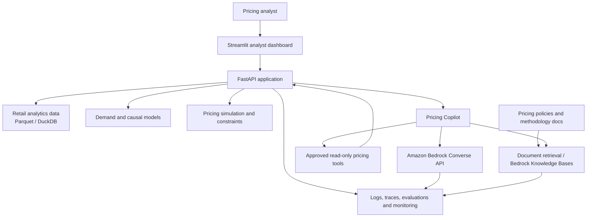

# Causal Dynamic Pricing for Retail

**An AI engineering portfolio project for retail pricing intelligence, causal demand analysis, and decision support.**

> **Project status: Planning and research.** This repository is being developed from an initial research idea into an end-to-end portfolio application. The models, API, AI assistant, AWS deployment, and dashboard described below are planned work unless a section is explicitly marked as implemented. No model performance or business impact results are claimed yet.

**Working product name:** MarginPilot  
**Repository:** [rzamaham/Causal-Dynamic-Pricing](https://github.com/rzamaham/Causal-Dynamic-Pricing)

---

## 1. Project vision

Retail pricing teams need to make decisions with incomplete information. They consider historical sales, current prices, promotions, seasonality, product costs, stock availability, and competitor activity. A price change can influence demand, revenue, margin, and customer perception.

This project will build a retail pricing decision-support application for a **pricing analyst or category manager**. The user should be able to:

1. Select a product and inspect its historical price, sales, and promotion context.
2. Understand what the available data says about demand and price sensitivity.
3. Compare alternative price scenarios.
4. See a recommendation that respects explicit business constraints.
5. Inspect the evidence, assumptions, uncertainty, and limitations behind the recommendation.
6. Ask questions in natural language and receive answers grounded in the application's data and tools.

The project combines retail analytics, causal inference, pricing optimization, backend engineering, LLM application development, cloud deployment, and operational evaluation.

### The central product principle

**Build for a real pricing decision, not for a list of fashionable AI tools.**

A database query or deterministic rule should be used when it is more reliable than an LLM. Statistical and optimization code should calculate pricing outputs. The LLM should help users navigate the system, call approved tools, and explain returned results. It should not invent metrics, replace the pricing logic, or automatically publish prices.

## 2. Customer problem and product scope

### Target user

A retail pricing analyst or category manager responsible for a product range who needs to understand the likely consequences of a price change before recommending it.

### Example user story

> As a category manager, I want to compare the current price with a few permitted alternatives, understand the expected demand and revenue implications, and see the assumptions behind the recommendation so I can decide whether to send it for approval.

### MVP workflow

1. **Choose a product:** identify the product, store or category, and analysis period.
2. **Inspect performance:** review historical prices, units sold, promotions, and relevant context available in the dataset.
3. **Estimate demand response:** use a transparent baseline first, followed by causal methods only when the data and identification assumptions support them.
4. **Compare scenarios:** evaluate a set of candidate prices using the selected demand model.
5. **Apply business rules:** enforce price bounds, permitted increments, maximum price movement, and cost/margin rules when the required inputs exist.
6. **Review the recommendation:** show expected outcomes, uncertainty, evidence, model version, and known limitations.
7. **Ask the Pricing Copilot:** use natural language to retrieve metrics, run approved simulations, and explain the returned results.
8. **Keep a human in control:** recommendations are proposals for review. The MVP does not change a live retail price.

### What success looks like

The first complete version should let a reviewer reproduce an analysis from documented input data and answer these questions:

- What data supports this recommendation?
- What changed in the product's price and sales history?
- Which model or rule produced the estimate?
- What assumptions and limitations apply?
- Which candidate prices were compared?
- What business constraints were enforced?
- What did the AI assistant retrieve or calculate, and which tools did it call?
- Can the application be tested, deployed, monitored, and run again by another engineer?

## 3. Product and engineering principles

The project follows the engineering approach from the supplied AI Engineer roadmap transcript.

### First-principles and customer thinking

- Begin with one user, one recurring pricing decision, and one measurable problem.
- Write a short scope before implementing a feature: what is being built, why it matters, and how it will be checked.
- Challenge whether AI is needed for each component. Prefer SQL, deterministic Python functions, and business rules when they solve the problem more cheaply and reliably.
- Keep a decision log explaining why a feature or technology was selected.

### Where this project sits in the AI stack

The video describes a five-layer AI stack: energy, chips, cloud/infrastructure, models, and applications/agents. This portfolio project is not intended to build chips, operate data centers, or train a foundation model. Its engineering focus is the top three software-facing layers:

- **Application:** the analyst dashboard, pricing workflow, APIs, and assistant.
- **Models:** selecting and integrating a suitable foundation model, plus the separate demand and causal models used by the pricing engine.
- **Cloud/infrastructure:** deploying, securing, and operating the application and model integrations on AWS.

Understanding the lower layers is useful context, but building them is outside this project's scope.

### End-to-end software ownership

Treat the application as a product lifecycle, not a notebook that ends when a model runs:

1. Requirements and acceptance criteria.
2. Design and implementation.
3. Code review and automated testing.
4. Release and deployment.
5. Monitoring, incident diagnosis, and fixes.
6. Documentation and reproducibility.

AI coding tools can help plan, implement, explain, and review code, but the project owner remains responsible for understanding, testing, and shipping the result. A change is not complete merely because an AI coding agent says it is complete.

### AI-assisted development loop

For each meaningful change:

1. Write the scope first: user problem, expected behavior, constraints, and acceptance checks.
2. Ask the coding assistant to inspect the relevant code and propose a plan before editing.
3. Implement a small change rather than asking for a broad, unreviewable rewrite.
4. Inspect the diff and ask for an explanation of unfamiliar code or dependencies.
5. Run tests, type checks, linters, and the application workflow affected by the change.
6. Request a separate review where possible. For a solo portfolio project, use a pull-request checklist and an independent second-pass review; automated or AI review is helpful but is not a substitute for engineering accountability.
7. Record what was changed, what was tested, what was rejected, and any remaining risk.

### Trust and decision safety

- Distinguish observed patterns, forecasts, and causal estimates.
- Do not infer sales impact from a price-only dataset.
- Do not claim a causal competitor reaction without matched competitor observations and a credible identification strategy.
- Show data sources and assumptions with recommendations.
- Abstain or ask for missing information rather than inventing values.
- Require human review before any future price publication or operational action.

## 4. Research questions

### Primary research question

How can a retailer use observed sales and pricing data to understand demand response, compare pricing scenarios, and make constrained pricing recommendations while communicating the limits of the available evidence?

### Supporting questions

- How do prices, promotions, seasonality, products, and stores relate to observed unit sales?
- How do simple forecasting baselines compare with more complex demand models?
- What makes price assignment endogenous, and which available variables help address confounding?
- Which price effects can reasonably be interpreted causally, and which remain descriptive or predictive?
- Do price responses differ across products, stores, or categories in the available sample?
- How should recommendations account for uncertainty, price limits, promotion rules, and unit costs?
- What extra data is needed to estimate how competitors react to our price changes?
- Which tasks should be deterministic software, which should use an LLM, and which—if any—justify an agent workflow?

## 5. Project scope

### Core MVP

- Product problem statement and acceptance criteria.
- Data source audit, ingestion, validation, and reproducible transformations.
- Exploratory retail price and sales analysis.
- Demand forecasting baselines.
- Econometric and causal analysis with documented assumptions and diagnostics.
- Candidate-price scenario simulator.
- Constrained recommendation logic.
- FastAPI backend with validated request and response schemas.
- A simple analyst-facing dashboard.
- Amazon Bedrock integration for a Pricing Copilot with controlled tool calling.
- Evaluation cases for numerical tools and LLM responses.
- Docker packaging, automated tests, CI/CD, AWS deployment, logs, and basic monitoring.
- GitHub documentation, architecture diagram, and short demo video.

### Staged extensions

- RAG over pricing policies, business rules, methodology notes, and model documentation.
- Document-level access control and source citations for retrieved material.
- A read-only pricing investigation agent that can select approved tools, gather evidence, and prepare a recommendation for human review.
- MCP exposure for stable tools when interoperability is useful.
- Amazon Bedrock AgentCore for agent runtime, identity, gateway, and observability when the agent has a demonstrated production need.
- Matched competitor observations and a rival-response research module.
- A transparent simulated market for testing strategic pricing methods when real competitor data is unavailable.
- More advanced sequential decision methods only after a credible simulator or suitable longitudinal data exists.

### Explicit non-goals for the MVP

- Building or training a foundation model.
- Autonomous publication of retail prices.
- An LLM making pricing calculations without validated backend tools.
- Using RAG as a substitute for querying structured sales and price tables.
- Multi-agent orchestration before a single-agent workflow is useful and reliable.
- Reinforcement learning before there is a credible environment and evaluation method.
- Claiming production readiness or business lift from offline demonstrations.

## 6. Data strategy

The data determines which questions the project can answer. Inspect the real downloaded files, schema, coverage, and usage terms before selecting a model or making claims.

### Candidate primary dataset: dunnhumby — Breakfast at the Frat

[Official dunnhumby Source Files](https://www.dunnhumby.com/source-files/)

The official description says this dataset represents sales and promotion information for five products from three brands across four categories over 156 weeks. It describes unit sales, households, visits, and spend by product, store, and week, along with base price, shelf price, and promotional support.

**Planned use:** the first retail pricing pilot for exploratory analysis, demand baselines, promotion analysis, and price-response research.

**Limitations:** the sample covers a small product and category range. Its existence does not by itself prove that price effects are causally identified. Availability, inventory, competitor matching, and unit-cost coverage must be checked rather than assumed.

### Supplementary dataset: Product Retail Price Survey 2017–2025

[Original Kaggle dataset](https://www.kaggle.com/datasets/aradhanahirapara/product-retail-price-survey-2017-2025)

This is retained from the original repository concept and can support historical price movement and price comparison analysis, subject to inspection of its actual columns and documentation.

**Important limitation:** do not assume it contains unit sales, unit costs, inventory, promotion exposure, or matched competitor observations. If those fields are absent, use it for price-trend analysis—not demand elasticity or causal rival-response estimation.

### Competitor price data: later extension

A credible competitor-response dataset should match comparable products across retailers and time. Useful fields would include observed rival prices, own prices, timestamps, product identifiers, promotion indicators, availability, and ideally sales and cost context.

If those data cannot be sourced, create a synthetic competitive market only for software and policy experiments. Label every synthetic field and result clearly. Never present simulated rival reactions as evidence about real retailers.

### Data governance

- Record source, download date, usage terms, schema, transformations, and limitations.
- Keep restricted or large raw files out of Git.
- Store reproducible processed data in Parquet or another documented format.
- Use a clear data dictionary and validation checks.
- Do not expose customer-level or confidential fields in the public demo.
- Keep secrets, access tokens, and cloud credentials out of notebooks and source control.

## 7. Study and build roadmap

**Planning assumption:** 18 weeks at approximately 8–12 hours per week. Adjust the pace to the time available; the deliverables matter more than the calendar. Each week should produce visible evidence: a scope document, code, tests, an experiment, a diagram, or a short learning note.

| Week | Study focus | Build tasks | Evidence / deliverable |
|---|---|---|---|
| 1 | First-principles thinking, product judgment, retail pricing workflows, when AI is and is not appropriate | Define the pricing analyst persona, the decision to support, the user journey, success criteria, and MVP boundaries. Review public retail pricing briefs or job descriptions to validate the problem. | Product brief, user story, acceptance criteria, and a list of features deliberately not built. |
| 2 | AI engineering lifecycle, requirements, architecture, application/model/infrastructure layers, release and monitoring concepts | Read the existing repository. Create the initial architecture, component responsibilities, project board, decision log, and development workflow. | Architecture v1, project backlog, and codebase orientation notes. |
| 3 | Linux terminal, files and processes, networking basics, HTTP, DNS, requests and responses | Set up the local development environment. Practice running the app and tests from the terminal. Document how a browser request reaches the API and returns a response. | Environment setup guide and networking/API notes. |
| 4 | Python, Git, SQL, relational data modeling, APIs, databases, authentication, testing, reading an existing codebase | Create the Python package, lint/format/test setup, Git branching and pull-request workflow, initial database or analytical storage, and sample API contract. | Working project skeleton, first tests, API schema, and data model. |
| 5 | How LLMs work; tokens, context windows, hallucinations, latency, model capabilities, prompt structure, cost and quality trade-offs | Compare a small number of candidate models for the assistant's actual tasks. Define a model-selection scorecard and token/cost logging approach. | Model comparison notes and an initial assistant requirements document. |
| 6 | AI-assisted coding with an IDE or coding agent; planning, codebase explanation, scoped changes, review and test loops | Use an AI coding assistant on small, bounded issues. Write scope before implementation, inspect diffs, run tests, request review, and record what required correction. | AI-assisted development playbook and reviewed pull requests. |
| 7 | Retail data modeling, data quality, pandas or Polars, DuckDB, Parquet, exploratory analysis | Download and audit the candidate dataset. Build ingestion, schema checks, data dictionary, and reproducible transformations. | Data audit, source notes, and repeatable data pipeline. |
| 8 | Retail demand, promotions, seasonality, price variation, time-based validation, forecasting baselines | Build descriptive analysis and simple demand baselines. Use chronological holdouts and compare against simple benchmarks. | EDA report, baseline model, and evaluation report. |
| 9 | Causal inference foundations, confounding, price endogeneity, treatment/outcome definitions, causal diagrams | Define the causal question and target population. Draw a causal diagram, identify available confounders, check price variation and overlap, and document what cannot be identified. | Causal research design and assumptions document. |
| 10 | Econometrics and causal ML, fixed effects, robustness checks, heterogeneous effects, uncertainty | Implement defensible baseline analyses and compare candidate causal methods only where the data supports them. Report uncertainty and sensitivity. | Causal analysis notebook and limitations report. |
| 11 | Pricing decisions, revenue versus margin, optimization constraints, scenario analysis, decision support | Build deterministic price simulation and recommendation functions. Add configurable bounds, allowed price steps, maximum movement, and optional cost/margin inputs. | Tested pricing engine with reproducible scenario examples. |
| 12 | Backend engineering, FastAPI, Pydantic, API versioning, error handling, authentication, frontend basics | Expose product metrics, demand estimates, scenario simulation, and recommendations through APIs. Add the analyst dashboard. | Working local application and API documentation. |
| 13 | Amazon Bedrock, model invocation, Converse API, system prompts, tool calling, model selection | Connect the Pricing Copilot to Bedrock through a provider adapter. Add controlled tools for metrics, simulation, recommendation, and model assumptions. | Working assistant prototype with recorded tool calls and failure handling. |
| 14 | Containers, Amazon ECR, ECS with Fargate, IAM, VPC, secrets, Terraform, CI/CD, rollback | Package the application, deploy a small AWS environment, use least-privilege roles, automate checks and deployment, and document teardown. | Deployed test environment, infrastructure code, CI/CD workflow, and operations guide. |
| 15 | RAG, document preparation, chunking, embeddings, retrieval, citations, access control, abstention | Add retrieval over unstructured pricing policy, product documentation, methodology, and model cards. Keep structured metrics in SQL/API tools. Test retrieval quality separately from answer quality. | Grounded policy/methodology Q&A with citations and retrieval diagnostics. |
| 16 | Agent workflows, tool schemas, human approval, MCP concepts, Amazon Bedrock AgentCore | Add one bounded, read-only pricing investigation workflow. The agent may gather metrics, run scenarios, and draft a review note; it cannot publish prices. Evaluate MCP and AgentCore only if they improve interoperability or operational control. | Agent workflow diagram, tool permissions, human-approval boundary, and agent test cases. |
| 17 | AI evaluations, testing, tracing, logging, monitoring, reliability, latency, token usage, cost, security | Create a reviewed evaluation set. Track quality, tool correctness, retrieval, latency, errors, and cost. Add logs/traces and test failure paths, access controls, and prompt-injection resistance. | Evaluation report, monitoring dashboard, failure runbook, and release checklist. |
| 18 | Technical storytelling, documenting trade-offs, portfolio presentation, public communication | Polish GitHub, architecture diagram, setup guide, case study, short demo video, LinkedIn project entry, and a series of build notes. | Portfolio release with a reproducible demo and clear limitations. |

### Milestones

- **M1 — Product and foundations (Weeks 1–6):** a scoped product brief, architecture, software workflow, and model-selection understanding.
- **M2 — Data and pricing research (Weeks 7–11):** a reproducible dataset, demand baselines, documented causal analysis, and working pricing simulator.
- **M3 — AI application (Weeks 12–13):** an API, dashboard, and Bedrock-powered assistant using controlled tools.
- **M4 — Cloud and knowledge (Weeks 14–15):** a secure test deployment and a grounded document-retrieval feature.
- **M5 — Agent and operational quality (Weeks 16–17):** a bounded agent workflow, evals, traces, monitoring, and failure handling.
- **M6 — Portfolio launch (Week 18):** complete documentation, demo, and public project story.

## 8. Proposed system architecture

The system is split into deterministic pricing services and an AI interaction layer. The assistant calls approved backend tools; the pricing service owns data access, model execution, constraints, and calculations.



### Core components

| Component | Responsibility | Design principle |
|---|---|---|
| Data ingestion | Load source files and validate schema, dates, identifiers, and key fields | Reproducible and auditable transformations |
| Analytics storage | Store cleaned analytical data and support structured queries | Use SQL for structured retail facts |
| Demand and causal models | Estimate or forecast demand and document model limits | Prediction and causal inference are reported separately |
| Pricing engine | Compare candidate prices and enforce business rules | Deterministic, tested, and independent of the LLM |
| FastAPI service | Validate requests and expose application capabilities | Explicit API contracts and safe error handling |
| Analyst dashboard | Show product history, price scenarios, recommendations, and evidence | Make the decision reviewable |
| Pricing Copilot | Interpret user questions and call approved tools | Ground answers in tool results; abstain when unsupported |
| Document retrieval | Retrieve pricing policies, methodology, and product documentation | Cite sources and enforce permissions |
| Evaluation/observability | Record quality, failures, latency, token usage, and cost | Detect regressions before release |

## 9. Technology choices

These are proposed technologies, not a claim that they are already implemented. Choose the simplest tool that meets the project requirement and record important trade-offs.

| Layer | Initial choice | Why it fits |
|---|---|---|
| Main language | Python | Shared language for analytics, APIs, and AI integration |
| Data analysis | Pandas or Polars | Data exploration and transformations |
| Local analytics | DuckDB and Parquet | Lightweight, reproducible analytical workflow |
| Statistical/ML baseline | Statsmodels and scikit-learn | Transparent baselines and model comparison |
| Causal ML | EconML, if justified | Candidate toolkit for heterogeneous treatment-effect analysis |
| Optimization | SciPy or a transparent candidate-price search | Keep pricing rules deterministic and testable |
| Backend | FastAPI and Pydantic | Typed request/response validation |
| Frontend | Streamlit | Fast path to an analyst-facing demo |
| LLM platform | Amazon Bedrock | Managed model access and tool-use integration |
| Model API | Bedrock Converse API where supported | Common conversational interface across supported models; verify each model's feature compatibility |
| RAG | Bedrock Knowledge Bases or a small explicit retrieval implementation | Use only for unstructured policies and project documentation |
| Agent interoperability | MCP, as a later extension | Standardized tool exposure when multiple clients need the same tools |
| Agent runtime | Amazon Bedrock AgentCore, optional | Consider when secure agent runtime, identity, gateway, or observability is actually needed |
| Container runtime | Docker, Amazon ECR, ECS with Fargate | Portable application packaging and managed container execution |
| Cloud security | IAM, VPC, security groups, Secrets Manager | Least-privilege access and protected services/secrets |
| Infrastructure | Terraform | Reviewable, repeatable infrastructure changes |
| CI/CD | GitHub Actions with AWS OIDC | Automated checks and deployment without long-lived AWS credentials in GitHub secrets |
| Monitoring | CloudWatch and structured application logs | Operational visibility into errors, latency, and usage |
| Testing | Pytest | Unit, integration, API, and pricing-rule tests |

## 10. Amazon Bedrock and model integration plan

The initial LLM integration should be small and measurable.

### Model adapter

- Integrate through the AWS SDK and the Bedrock Converse API where the chosen model supports it.
- Keep the model identifier and inference settings in configuration, not scattered through application code.
- Build a small model comparison using task quality, tool-call correctness, latency, token usage, and cost.
- Do not assume all models support the same context size, tool use, streaming, or parameters just because a common API is available.
- Log model/version/configuration information needed to reproduce an evaluation, while avoiding unnecessary sensitive prompt retention.

### Prompt and response design

The system prompt should explain the assistant's role, available tools, response format, limits, and when it must say that the evidence is insufficient. Use structured tool inputs and validate all tool arguments in the backend. The backend must verify permissions and business constraints even when a tool call comes from an LLM.

### Initial tools

| Tool | Description | Permission |
|---|---|---|
| `get_product_metrics` | Retrieve historical product performance and available data coverage | Read-only |
| `get_price_history` | Retrieve observed price and promotion history | Read-only |
| `estimate_demand_response` | Request an estimate from a selected, versioned model | Read-only computation |
| `simulate_price_scenario` | Compare allowed candidate prices | Read-only computation |
| `recommend_price` | Return a constrained proposal with evidence and assumptions | Proposal only; no publishing |
| `get_model_assumptions` | Return model documentation and limitations | Read-only |

## 11. AWS deployment and security plan

The target is a small, cost-controlled demonstration environment—not an enterprise-scale production platform.

### Deployment path

1. Build and test the application locally.
2. Package the API and UI into Docker images.
3. Push images to Amazon ECR.
4. Deploy the application using ECS with Fargate.
5. Use a VPC and security groups to control network access. Keep data stores and internal services private where appropriate.
6. Give each workload an IAM task role with only the permissions it needs, including narrowly scoped Bedrock invocation access.
7. Store secrets in an appropriate secret manager; never commit credentials or `.env` files.
8. Provision cloud resources with Terraform and keep development/test/prod configuration separate if multiple environments are introduced.
9. Use GitHub Actions for tests and deployment. Prefer GitHub OIDC federation to long-lived AWS credentials.
10. Add health checks, logs, alarms, and a documented rollback process.

### Cost and safety guardrails

- Set an AWS budget and billing alerts before deploying.
- Start with the smallest practical resources and a short-lived test environment.
- Avoid always-on or expensive services unless they provide clear value to the demo.
- Track model token usage and request costs; cap repeated or oversized requests.
- Add request authentication and rate limits before exposing a public endpoint.
- Restrict CORS, network access, IAM permissions, and access to data files.
- Do not upload private retail or personal data to a public demo.
- Include explicit Terraform destroy/cleanup instructions and verify that paid resources are removed after experiments.

## 12. RAG: policies and documentation, not sales arithmetic

The project should use retrieval-augmented generation only where document retrieval is useful.

### Good RAG sources

- Pricing and promotion policies.
- Product or category guidance.
- Model cards and methodology notes.
- Data dictionaries and source documentation.
- Business definitions and recommendation review procedures.

### Do not use RAG for

- Exact product sales totals.
- Current observed prices.
- Scenario calculations.
- Margin calculations.
- Constraint checks.

Those belong in structured data queries and deterministic backend functions.

### RAG stages and trust requirements

1. Collect and clean approved documents.
2. Split documents into useful sections and preserve metadata such as source, version, category, and access scope.
3. Create embeddings and index the content using an approved retrieval store.
4. Retrieve relevant sections for a user question.
5. Generate an answer constrained to the retrieved evidence.
6. Return citations or source references so the user can inspect the evidence.

Test four production questions explicitly:

- Is the user allowed to retrieve this document?
- Can the answer show where the information came from?
- Does the assistant abstain when no supporting information is found?
- When the answer is wrong, can the team determine whether retrieval failed or generation failed?

## 13. Agent and MCP extension

Agents are not part of the first working MVP. Add them only after the pricing tools are reliable and the workflow benefits from a model choosing among multiple steps.

### Candidate bounded agent task

**Prepare a pricing review for a selected product.** The agent may:

1. Retrieve product performance and price history.
2. Retrieve relevant policy and methodology documents.
3. Request approved price scenarios from the pricing service.
4. Compare the returned options and assumptions.
5. Draft a recommendation note with citations and unresolved questions.
6. Stop and request human review.

### Safety boundary

The agent must not publish a price, edit business rules, change model configurations, or access customer data beyond its explicit permissions. Tool calls should be logged and visible. Sensitive or consequential operations require explicit human approval.

### MCP and AgentCore

- Consider MCP when the same stable tool set needs to be exposed to multiple compatible clients or agent frameworks.
- Consider Amazon Bedrock AgentCore if the project needs managed agent runtime, gateway, identity, or agent observability.
- Do not add either solely to increase the technology count. A simple application-owned tool interface is sufficient for the first version.

## 14. Evaluation, monitoring, and operations

AI features are not reliable merely because a few demo prompts work. Maintain a versioned evaluation set and rerun it when prompts, models, tools, retrieval settings, or source documents change.

### Evaluation layers

| Layer | What to check |
|---|---|
| Data | Schema validity, missing values, key integrity, data freshness, reproducibility |
| Demand model | Chronological holdout performance, baseline comparison, forecast bias, segment behavior |
| Causal analysis | Identification assumptions, confounding, overlap, sensitivity, placebo or negative-control checks where suitable, uncertainty reporting |
| Pricing engine | Correct candidate generation, business-rule enforcement, price bounds, stable outputs, cost/margin handling |
| Retrieval | Whether the correct document sections are found, access filters work, source citations are present, unsupported questions abstain |
| LLM assistant | Tool selection, argument validity, grounding in returned tool results, consistency, refusal to invent unavailable values |
| Agent | Correct sequence of tool use, stopping behavior, permissions, human-review boundary, trace completeness |
| Application | API contract tests, authentication, error handling, availability, performance, security checks |

### Operational signals

Monitor and review:

- Request volume and error rates.
- API and end-to-end response latency.
- Model latency and timeout rates.
- Input/output token usage and estimated cost.
- Tool-call frequency, failures, and invalid arguments.
- Retrieval hit quality and citation coverage.
- Evaluation scores and regressions after changes.
- Deployment version and model/prompt configuration.

Use logs and traces to locate where a failed answer originated: source data, retrieval, tool execution, model generation, or application logic. Avoid logging secrets or unnecessary personal data.

### Release rule

A change should not be released just because it runs. It should pass automated software tests and the relevant model, retrieval, and tool evaluations. Document accepted trade-offs and any known regression.

## 15. Proposed repository structure

The repository currently begins with the research README. The following is a target structure to introduce incrementally; it does not imply that these folders or components already exist.

```text
causal-dynamic-pricing/
├── README.md
├── pyproject.toml
├── Dockerfile
├── docker-compose.yml
├── data/
│   ├── README.md
│   ├── raw/                 # local only; do not commit restricted data
│   └── processed/
├── notebooks/
│   ├── 01_data_audit.ipynb
│   ├── 02_retail_eda.ipynb
│   ├── 03_demand_baselines.ipynb
│   └── 04_causal_analysis.ipynb
├── src/
│   └── pricing/
│       ├── data/
│       ├── features/
│       ├── forecasting/
│       ├── causal/
│       ├── optimization/
│       ├── api/
│       └── copilot/
│           └── tools/
├── app/
│   └── streamlit_app.py
├── pipelines/
│   ├── ingest.py
│   ├── transform.py
│   └── train.py
├── infrastructure/
│   └── terraform/
├── evals/
│   ├── demand/
│   ├── causal/
│   ├── retrieval/
│   ├── copilot/
│   └── agent/
├── tests/
│   ├── unit/
│   ├── integration/
│   └── api/
├── docs/
│   ├── product_brief.md
│   ├── data_dictionary.md
│   ├── causal_assumptions.md
│   ├── architecture.md
│   ├── decisions/           # architecture and trade-off records
│   ├── evaluation_report.md
│   ├── operations.md
│   └── limitations.md
└── .github/
    └── workflows/
        └── ci.yml
```

## 16. Portfolio proof of work

The final portfolio should make the engineering decisions visible, not just show a dashboard screenshot.

### GitHub repository

Include:

- A clear project description and setup guide.
- A system architecture diagram.
- A documented data source and data dictionary.
- A short explanation of modeling assumptions and causal limitations.
- Evaluation results with the dataset, split, configuration, and date used.
- Tests and CI status.
- Deployment instructions and a teardown guide.
- Decision records explaining important trade-offs.
- Known issues and future work.

### Demo video

Record a short walkthrough (approximately 3–5 minutes):

1. Introduce the pricing analyst and the business decision.
2. Show a product's historical price and sales context.
3. Run a price scenario and explain the constraints.
4. Ask the Pricing Copilot a question and show the tools it calls.
5. Show how citations, uncertainty, and limitations are presented.
6. Briefly show the architecture, tests, and deployment.

### Public build notes

Publish concise progress updates about:

- What problem was addressed that week.
- What was built and how it was tested.
- One technical decision and the alternatives considered.
- What failed or changed after review.
- What will be built next.

Add the repository and demo to the relevant portfolio and professional profiles. Do not claim a business outcome that has not been measured.

## 17. Definition of done checklist

Use this checklist as the project acceptance gate. Check an item only when there is evidence in the repository or deployed application.

### Product and data
- [ ] The target user, decision, and MVP scope are documented.
- [ ] The data source, licence/terms, schema, and limitations are recorded.
- [ ] Data ingestion and validation can be reproduced.
- [ ] Raw data is not accidentally committed.

### Analytics and pricing
- [ ] Descriptive analysis and demand baselines are reproducible.
- [ ] Causal questions, assumptions, diagnostics, and limitations are documented.
- [ ] The pricing simulator uses deterministic backend logic.
- [ ] Business constraints are tested.
- [ ] Recommendations distinguish observed, predicted, and causally estimated quantities.

### AI application
- [ ] The API has documented request and response schemas.
- [ ] The assistant uses approved tools for all numerical pricing operations.
- [ ] Model selection is documented with quality, latency, and cost trade-offs.
- [ ] The assistant can abstain when data or evidence is missing.
- [ ] RAG content has source metadata, access controls, and citations.
- [ ] Agent actions are limited, logged, and subject to human review.

### Cloud and operations
- [ ] Docker build and local run instructions work.
- [ ] AWS permissions follow least privilege.
- [ ] Secrets and credentials are not stored in Git.
- [ ] Infrastructure can be recreated and removed from documented instructions.
- [ ] CI runs tests before deployment.
- [ ] Logs, traces, latency, errors, and model costs are visible.
- [ ] Evaluation cases run after relevant model, prompt, tool, or retrieval changes.

### Portfolio
- [ ] README reflects the actual implementation status.
- [ ] Architecture diagram matches the deployed system.
- [ ] Evaluation report contains measured results and methodology.
- [ ] Demo video shows the real application.
- [ ] Limitations and trade-offs are easy to find.

## 18. References and learning resources

### Retail data and pricing

- [dunnhumby Source Files](https://www.dunnhumby.com/source-files/) — candidate retail sales, price, and promotion data.
- [Product Retail Price Survey 2017–2025](https://www.kaggle.com/datasets/aradhanahirapara/product-retail-price-survey-2017-2025) — supplementary price observations from the original draft.

### Software engineering foundations

- [The Missing Semester of Your CS Education](https://missing.csail.mit.edu/) — shell, command line, Git, and practical developer tools.
- [Python Tutorial](https://docs.python.org/3/tutorial/) — Python language foundations.
- [Git Book](https://git-scm.com/book/en/v2) — version control and collaboration.
- [FastAPI Tutorial](https://fastapi.tiangolo.com/tutorial/) — API development.
- [PostgreSQL Documentation](https://www.postgresql.org/docs/) — relational database concepts.

### Causal inference and modeling

- [The Effect](https://theeffectbook.net/) — causal inference and research design.
- [Causal Inference: The Mixtape](https://mixtape.scunning.com/) — econometric causal methods.
- [EconML](https://www.pywhy.org/EconML/) — causal machine learning.
- [Statsmodels](https://www.statsmodels.org/) — statistical modeling.
- [scikit-learn](https://scikit-learn.org/stable/) — machine learning baselines.

### AWS and AI engineering

- [Amazon Bedrock Converse API](https://docs.aws.amazon.com/bedrock/latest/userguide/conversation-inference.html) — conversational model inference and tool use.
- [Amazon Bedrock Knowledge Bases](https://docs.aws.amazon.com/bedrock/latest/userguide/knowledge-base.html) — document retrieval and grounded generation.
- [Amazon Bedrock Guardrails](https://docs.aws.amazon.com/bedrock/latest/userguide/guardrails.html) — controls for supported model and knowledge-base workflows.
- [Amazon Bedrock AgentCore](https://docs.aws.amazon.com/bedrock-agentcore/latest/devguide/what-is-bedrock-agentcore.html) — optional managed agent capabilities.
- [Model Context Protocol](https://modelcontextprotocol.io/) — standard for exposing tools and other context to compatible clients.
- [AWS Fargate](https://aws.amazon.com/documentation-overview/fargate/) — managed compute for containers.
- [GitHub Actions OIDC with AWS](https://docs.github.com/en/actions/how-tos/secure-your-work/security-harden-deployments/oidc-in-aws) — short-lived workflow authentication to AWS.
- [AWS Well-Architected Generative AI Lens](https://docs.aws.amazon.com/wellarchitected/latest/generative-ai-lens/generative-ai-lens.html) — operational, security, reliability, and performance considerations.
- [Streamlit Documentation](https://docs.streamlit.io/) — analyst-facing application UI.

---

## Project status and contribution

This is a personal learning and portfolio project. The roadmap is deliberately staged: the first goal is a trustworthy pricing application with reproducible data and deterministic business logic; document retrieval and agents come later when there is a clear need.

As implementation progresses, update this README so that completed features, evaluation results, architecture, and deployment instructions always match the actual code.

**Author:** `Your Name`  
**Status:** Research and planning; implementation milestones to be updated as completed.
